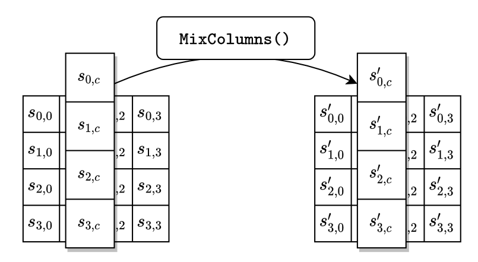

# AES-128 in Python

A from-scratch implementation of AES-128 (ECB and CBC modes). The code follows the pseudocode in [FIPS 197](https://doi.org/10.6028/NIST.FIPS.197-upd1) so you can read the standard and the source side by side.

## Contents

1. [About AES](#1-about-aes)
2. [AES vs DES](#2-aes-vs-des)
3. [AES step by step](#3-aes-step-by-step)

---

## 1. About AES

### What it is

The Advanced Encryption Standard (AES) is a symmetric block cipher: one secret key encrypts and the same key decrypts. It takes a 128-bit block of data and a key, and returns a 128-bit block. NIST published it as FIPS 197, and it is the algorithm most systems use today for encrypting data at rest and in transit (TLS, WPA2 Wi-Fi, and disk encryption all rely on it).

The standard defines three variants. They share the same block size and differ in key length and number of rounds:

| Variant | Key length | Block size | Rounds (Nr) | Key words (Nk) |
|---------|-----------|------------|-------------|----------------|
| AES-128 | 128 bits  | 128 bits   | 10          | 4              |
| AES-192 | 192 bits  | 128 bits   | 12          | 6              |
| AES-256 | 256 bits  | 128 bits   | 14          | 8              |

This project implements **AES-128**.

### History

| Year | Event |
|------|-------|
| 1977 | DES becomes a US federal standard (FIPS 46). Its key is 56 bits long. |
| 1997 | NIST opens a public competition to find a successor to DES and asks for candidate block ciphers. |
| 1998 | The Electronic Frontier Foundation builds a machine ("Deep Crack") that recovers a DES key by brute force in under three days. |
| 1999 | Five finalists remain: MARS, RC6, Rijndael, Serpent, and Twofish. |
| 2000 | NIST selects **Rijndael**, designed by the Belgian cryptographers Joan Daemen and Vincent Rijmen. |
| 2001 | FIPS 197 is published on November 26. The standard becomes effective on May 26, 2002. |
| 2005 | NIST withdraws DES (FIPS 46-3). |
| 2023 | FIPS 197 receives an update (May 9). The changes are editorial, and the algorithm stays the same. |

Rijndael supports more block sizes and key lengths than the standard adopted. AES fixes the block size at 128 bits and allows three key lengths.

---

## 2. AES vs DES

DES (Data Encryption Standard) preceded AES by about 25 years. Comparing the two shows what changed in cipher design and why DES retired.

| Property | DES | AES |
|----------|-----|-----|
| Standard | FIPS 46 (1977), withdrawn in 2005 | FIPS 197 (2001), current |
| Designers | IBM, with input from NSA | Joan Daemen and Vincent Rijmen |
| Block size | 64 bits | 128 bits |
| Key size | 56 effective bits (64 with 8 parity bits) | 128, 192, or 256 bits |
| Rounds | 16 | 10, 12, or 14 |
| Structure | Feistel network | Substitution-permutation network |
| Unit of work | Bit-level permutations | Byte-level operations |
| Substitution | 8 S-boxes, each maps 6 bits to 4 bits | 1 S-box, maps 8 bits to 8 bits, defined by math (inverse in GF(2^8) plus an affine map) |
| Decryption | Same circuit, subkeys in reverse order | Separate inverse operations (InvSubBytes, InvShiftRows, InvMixColumns) |
| Brute-force cost | 2^56 keys, within reach of dedicated hardware | 2^128 keys or more, out of reach |


### Advantages of AES

1. **Larger key space.** A 56-bit key falls to brute force. A 128-bit key does not, and 192 and 256 bits add more margin.
2. **Larger block.** A 64-bit block starts repeating after roughly 2^32 blocks (about 32 GiB) under CBC, which enables practical attacks on long-lived connections. A 128-bit block pushes that limit to about 2^64 blocks.
3. **Faster in software.** AES works on whole bytes. DES relies on bit permutations that are cheap in hardware and slow in software. Most current CPUs also include dedicated AES instructions.
4. **Transparent construction.** The AES S-box has an explicit mathematical definition (FIPS 197, Section 5.1.1). Every constant in the standard has a stated derivation.
5. **Flexible key length.** One design covers three security levels.

### What AES does not give you

AES protects confidentiality of a single block. The surrounding system decides whether the result is secure:

- **ECB mode leaks patterns.** Identical plaintext blocks produce identical ciphertext blocks.
- **No integrity.** ECB and CBC detect no tampering. Modern systems use an authenticated mode such as GCM.
- **Implementation attacks.** FIPS 197 (Section 6.4) warns that software implementations can leak key information through timing and cache behavior. This project is for learning and is not constant-time.

DES stays useful as a pedagogic purpose. Its Feistel structure is simple, and decryption reuses the encryption circuit.

---

## 3. AES step by step

### 3.1 Data layout: the state

AES works on a 4 x 4 grid of bytes called the **state**. The 16 input bytes fill the grid column by column:

```
input bytes             state
in0  in4  in8  in12     s0,0  s0,1  s0,2  s0,3
in1  in5  in9  in13     s1,0  s1,1  s1,2  s1,3
in2  in6  in10 in14     s2,0  s2,1  s2,2  s2,3
in3  in7  in11 in15     s3,0  s3,1  s3,2  s3,3
```

The rule is `s[r][c] = in[r + 4*c]`. After all rounds, the state is copied back to the output in the same order.

### 3.2 Overview of encryption

For AES-128 (Nr = 10):

1. Copy the input block into the state.
2. Expand the 16-byte key into 11 round keys (44 words).
3. **Round 0:** `AddRoundKey` with round key 0.
4. **Rounds 1 to 9:** `SubBytes`, `ShiftRows`, `MixColumns`, `AddRoundKey`.
5. **Round 10 (final):** `SubBytes`, `ShiftRows`, `AddRoundKey`. This round has no `MixColumns`.
6. Copy the state to the output block.


### 3.3 GF(2^8)

AES treats each byte as a polynomial with coefficients 0 or 1. For example, `{57}` = `01010111` = `x^6 + x^4 + x^2 + x + 1`. Two operations matter:

- **Addition** is XOR. `{57} xor {83} = {d4}`.
- **Multiplication** multiplies the polynomials, then reduces the result modulo `m(x) = x^8 + x^4 + x^3 + x + 1`, which is `0x11B`.

Multiplying by `{02}` is called `xtime`: shift the byte left by one bit, and if the bit shifted out was 1, XOR the result with `0x1B`. Larger products come from repeated `xtime` and XOR. For example, since `{13} = {10} xor {02} xor {01}`:

```
{57} * {01} = {57}
{57} * {02} = {ae}
{57} * {10} = {07}
{57} * {13} = {57} xor {ae} xor {07} = {fe}
```

### 3.3 Key expansion

The 16-byte key becomes a key schedule `w` of 44 four-byte words, which gives 11 round keys of 4 words each.

```
w[0..3]  = the key itself
for i = 4 to 43:
    temp = w[i-1]
    if i mod 4 == 0:
        temp = SubWord(RotWord(temp)) xor Rcon[i/4]
    w[i] = w[i-4] xor temp
```

- `RotWord([a0,a1,a2,a3]) = [a1,a2,a3,a0]`
- `SubWord` applies the S-box to each of the 4 bytes.
- `Rcon[j]` is the round constant `[x^(j-1), 00, 00, 00]`:

| j | 1 | 2 | 3 | 4 | 5 | 6 | 7 | 8 | 9 | 10 |
|---|---|---|---|---|---|---|---|---|---|----|
| Rcon[j] (first byte) | 01 | 02 | 04 | 08 | 10 | 20 | 40 | 80 | 1b | 36 |

**Example** with key `2b7e151628aed2a6abf7158809cf4f3c`, computing `w[4]`:

```
w[3]                    = 09cf4f3c
RotWord                 = cf4f3c09
SubWord                 = 8a84eb01
xor Rcon[1] (01000000)  = 8b84eb01
xor w[0] (2b7e1516)     = a0fafe17   <- w[4]
```

The last word of the schedule is `w[43] = b6630ca6`.

### 3.4 SubBytes

Each byte of the state is replaced by its S-box value. The S-box combines two steps:

1. Replace the byte `b` with its multiplicative inverse in GF(2^8). The byte `{00}` stays `{00}`.
2. Apply an affine transformation to the bits, with constant `c = {63}`:

```
b'_i = b_i xor b_(i+4) xor b_(i+5) xor b_(i+6) xor b_(i+7) xor c_i     (indices mod 8)
```

Implementations skip the math and use a 256-entry lookup table. The high hex digit of the input selects the row, and the low digit selects the column. For example, `{53}` becomes `{ed}`.

*In the code:* `sub_bytes` and `const.S_BOX`.


### 3.5 ShiftRows

Row `r` of the state rotates left by `r` positions. Row 0 does not move.

```
before                  after
s00 s01 s02 s03         s00 s01 s02 s03    (shift 0)
s10 s11 s12 s13         s11 s12 s13 s10    (shift 1)
s20 s21 s22 s23         s22 s23 s20 s21    (shift 2)
s30 s31 s32 s33         s33 s30 s31 s32    (shift 3)
```

Formula: `s'[r][c] = s[r][(c + r) mod 4]`.

*In the code:* `shift_rows`.


### 3.6 MixColumns

Each column of the state is multiplied by a fixed matrix, using GF(2^8) arithmetic:

```
| s'0 |   | 02 03 01 01 |   | s0 |
| s'1 | = | 01 02 03 01 | * | s1 |
| s'2 |   | 01 01 02 03 |   | s2 |
| s'3 |   | 03 01 01 02 |   | s3 |
```

Written out for one column:

```
s'0 = (02 * s0) xor (03 * s1) xor s2 xor s3
s'1 = s0 xor (02 * s1) xor (03 * s2) xor s3
s'2 = s0 xor s1 xor (02 * s2) xor (03 * s3)
s'3 = (03 * s0) xor s1 xor s2 xor (02 * s3)
```

**Example:** the column `db 13 53 45` becomes `8e 4d a1 bc`. For the first output byte:

```
02 * db = ad        03 * 13 = 35
s'0 = ad xor 35 xor 53 xor 45 = 8e
```



### 3.7 AddRoundKey

Each column of the state is XORed with one word of the round key:

```
[s'0,c  s'1,c  s'2,c  s'3,c] = [s0,c  s1,c  s2,c  s3,c] xor w[4 * round + c]     for c = 0..3
```

This is the only step that uses the key. XOR is its own inverse, so decryption applies the same operation.


### 3.8 Worked example (FIPS 197, Appendix B)

Input `3243f6a8885a308d313198a2e0370734`, key `2b7e151628aed2a6abf7158809cf4f3c`. Each matrix below is shown row by row, in hex.

**Initial state and round key 0:**

```
input state         round key 0         after AddRoundKey (start of round 1)
32 88 31 e0         2b 28 ab 09         19 a0 9a e9
43 5a 31 37         7e ae f7 cf         3d f4 c6 f8
f6 30 98 07         15 d2 15 4f         e3 e2 8d 48
a8 8d a2 34         16 a6 88 3c         be 2b 2a 08
```

**Round 1:**

```
after SubBytes      after ShiftRows     after MixColumns    round key 1         start of round 2
d4 e0 b8 1e         d4 e0 b8 1e         04 e0 48 28         a0 88 23 2a         a4 68 6b 02
27 bf b4 41         bf b4 41 27         66 cb f8 06         fa 54 a3 6c         9c 9f 5b 6a
11 98 5d 52         5d 52 11 98         81 19 d3 26         fe 2c 39 76         7f 35 ea 50
ae f1 e5 30         30 ae f1 e5         e5 9a 7a 4c         17 b1 39 05         f2 2b 43 49
```

Rounds 2 to 9 repeat the same four steps. Round 10 skips `MixColumns`. The final output is:

```
3925841d02dc09fbdc118597196a0b32
```

The full table of intermediate values for all rounds is in Appendix B of FIPS 197.

### 3.9 Decryption

Decryption undoes each step in reverse order, using the same round keys in reverse:

1. `AddRoundKey` with round key `Nr`.
2. For rounds `Nr-1` down to `1`: `InvShiftRows`, `InvSubBytes`, `AddRoundKey` with that round's key, `InvMixColumns`.
3. Final step: `InvShiftRows`, `InvSubBytes`, `AddRoundKey` with round key 0.

The inverse operations are:

- `InvShiftRows` rotates row `r` right by `r` positions: `s'[r][c] = s[r][(c - r) mod 4]`.
- `InvSubBytes` uses the inverse S-box table (`const.INV_S_BOX`).
- `InvMixColumns` multiplies each column by the matrix with entries `0e 0b 0d 09` (each row rotated one position right, `const.INV_MIX_MATRIX`).

*In the code:* `inv_cipher(state, words, Nr)` and `decrypt(ciphertext, key)`.


---

## Reference

https://www.geeksforgeeks.org/computer-networks/advanced-encryption-standard-aes/

https://braincoke.fr/blog/2020/08/the-aes-decryption-algorithm-explained/

National Institute of Standards and Technology (2001). *Advanced Encryption Standard (AES)*. FIPS 197, updated May 9, 2023. <https://doi.org/10.6028/NIST.FIPS.197-upd1>